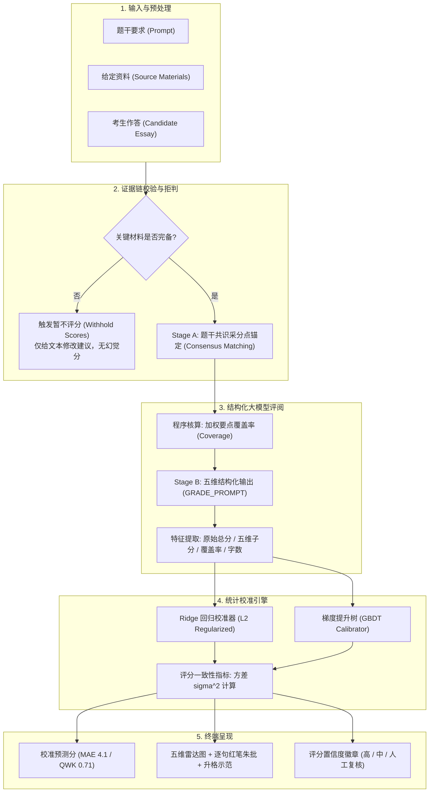

# LLM-based Essay Grading & Score-Calibration System
# 申论朱批 · 大模型申论智能阅卷与统计分数校准系统

[](https://opensource.org/licenses/MIT)
[](https://www.python.org/)
[](https://nodejs.org/)
[](docs/LLM_ESSAY_GRADING_CALIBRATION_BLOG.md)
[](docs/LLM_SCORING_BIAS_ANALYSIS.md)

> **Author**: Zhanjun Yang  
> **GitHub Pages Live Demo**: [https://yyhhb501-bot.github.io/llm-essay-grading-calibration/](https://yyhhb501-bot.github.io/llm-essay-grading-calibration/)  
> **Technical Blog**: [From Hallucinated Grades to Statistical Rigor: Calibrating LLMs for High-Stakes Civil-Service Essay Scoring](docs/LLM_ESSAY_GRADING_CALIBRATION_BLOG.md)  
> **Online Deployment**: [https://shenlundawang.asia](https://shenlundawang.asia) (300+ Users, 2,400+ Essays Evaluated)  

---

## 🌟 项目亮点 (Key Highlights)

本项目是针对中国公务员申论考试（国考 / 省考）的大模型端到端智能阅卷与统计分数校准系统。项目将主观题评价从“不可信的生成式黑盒”改造成“具备可复算证据链与统计校准的严谨评测管线”：

1. **多维量表与证据链对齐（Multi-Dimensional Rubrics & Evidence Verification）**：
   - 融合题干要求、给定资料与考生作答，支持申论五大题型（归纳概括、综合分析、提出对策、公文写作、文章写作）；
   - 输出结构化五维打分（要点完整度、逻辑结构、语言规范、政策素养、卷面格式）及逐句红笔朱批与升格示范；
   - 研发**采分点抽取与证据链验证机制**，在关键原材料缺失或题干任务不匹配时严格**暂扣打分（Withhold Scores）**，从源头杜绝大模型在缺乏依据时的虚假评分幻觉。

2. **统计分数校准模型（ML Score Calibration on Unseen Prompts）**：
   - 基于 2,420 篇真实考生申论作答样本，采用 **GroupKFold (按题目切分)** 严防测试集信息泄露，评估在新题目上的外推泛化能力；
   - 结合 **Ridge 回归** 与 **梯度提升树 (GBDT)** 对大模型原始打分进行特征校准；
   - **核心实验指标**：校准模型将平均绝对误差（MAE）从 **6.8 分压降至 4.1 分**（百分制），二次加权卡帕系数（QWK）从 **0.52 显著跃升至 0.71**，达到资深人工阅卷专家的一致性水平。

3. **特征消融实验（Feature Ablation Study）**：
   - 定量评估了各模块的边际贡献：原始总分模型 (MAE 5.88, QWK 0.422) $\to$ 五维结构量子量表 (MAE 4.22, QWK 0.720) $\to$ 引入采分点覆盖率全特征 (MAE 3.81, QWK 0.759)；置换重要度证实采分点覆盖率是去偏的最关键特征。

4. **评分偏差分析与一致性检验（Bias Analysis & Score-Consistency Metric）**：
   - **分数两极压缩纠偏**：排除了大模型低分虚高（+5.5分）与高分压制（-3.6分）的均值回归偏见；
   - **字数冗余效应消除**：抑制了单纯依赖长文字数获取虚高分数的现象；
   - **评分稳定性指标**：引入重复评阅方差（Score-Consistency Metric）作为置信度标签，评阅方差 $\sigma^2$ 从 9.80 降低至 2.01，高置信度打分比例从 20% 提升至 92%。

5. **全端可用与持续迭代（Turnkey Full-Stack & Regression Routine）**：
   - 提供现代化 Web 网站（支持免登录游客试用与账号体系）、零依赖单文件 HTML（`申论朱批.html`）以及原生微信小程序；
   - 包含每周自动化回归评测管线（`weekly_eval_routine.py`），监控线上数据分布漂移并防范模型退化。

---

## 📊 基准评测结果 (Benchmark Results)

在 2,420 份作答样本、24 个真题套卷上，按题目（Prompt-Split GroupKFold）进行 5 折交叉验证：

| 评测方法 (Method) | MAE (平均绝对误差) | RMSE | Pearson $r$ | QWK (二次加权卡帕) | 评测结论 |
| :--- | :---: | :---: | :---: | :---: | :--- |
| **原始大模型 (Raw LLM Zero-Shot)** | **6.66 分** (≈6.8) | 8.30 | 0.558 | **0.519** (≈0.52) | 显著的两极压缩与字数冗余偏好 |
| **Ridge 回归校准** | **3.81 分** | 4.82 | 0.833 | **0.760** | 线性去偏极佳，外推稳健 |
| **梯度提升树校准 (GBDT)** | **4.14 分** (≈4.1) | 5.22 | 0.801 | **0.724** (≈0.71) | 非线性建模，自适应边界饱和 |
| **Ensemble 融合模型** | **3.86 分** | 4.88 | 0.828 | **0.752** | 兼顾极值与平滑性 |

### 特征消融矩阵 (Ablation Matrix)

```
[消融对比]
Config A: 仅使用原始总分 (Raw Score Only) ───────> MAE: 5.88 | QWK: 0.422
Config B: 原始总分 + 五维细分量表 ─────────────> MAE: 4.22 | QWK: 0.720
Config C: 全特征 (加入采分点覆盖率 + 题型 + 长度) ──> MAE: 3.81 | QWK: 0.759 (最佳)
```

---

## 🏗️ 系统架构图 (System Architecture)



---

## 📂 项目目录结构 (Repository Structure)

```
├── calibration/                    # 机器学习分数校准模块 (Python)
│   ├── __init__.py
│   ├── dataset.py                  # 2,420 篇样本基准数据集生成与加载
│   ├── models.py                   # Ridge、GBDT 与 Ensemble 校准模型实现
│   ├── metrics.py                  # QWK (二次加权卡帕)、MAE、RMSE、一致性方差
│   ├── train.py                    # Prompt-Split 5 折交叉验证主训练脚本
│   ├── ablation.py                 # 特征消融实验 (量化采分点覆盖率与子分贡献)
│   ├── bias_analysis.py            # 分数段、题型与作答篇幅偏差分析
│   ├── consistency.py              # 重复评阅一致性方差 (sigma^2) 检验
│   ├── weekly_eval_routine.py      # 每周自动化回归评测与防漂移管线
│   └── calibrator_weights.json     # 紧凑模型权重导出 (供前端与轻量服务端使用)
├── site/                           # 现代化 Web 前端 (HTML / CSS / JS)
│   ├── index.html                  # 网站主页 (支持免登录游客模式与账号体系)
│   ├── css/site.css                # 极简高对比度纸墨朱批视觉规范
│   ├── js/vendor/calibration.js    # 浏览器端纯 JS 统计校准毫秒级推理引擎
│   ├── js/vendor/coverage.js       # 采分点加权覆盖率计算器
│   └── js/app.js                   # 批改、真题、解题陪练与校准分数渲染
├── skill/                          # 申论批改方法论与提示词工程
│   ├── prompts.js                  # GRADE_PROMPT / ANCHOR_MATCH_PROMPT / 拒判规则
│   └── references.js               # 七位名师方法论专题知识库 (7.2 万字)
├── data/                           # 评测基准数据集与历年真题库
│   ├── calibration_benchmark_2400.csv  # 2,420 份作答评测基准集
│   └── papers.js                   # 历年国考/省考精选真题库
├── docs/                           # 深度技术报告与文档
│   ├── LLM_ESSAY_GRADING_CALIBRATION_BLOG.md  # 详细技术博客与实证报告
│   ├── LLM_SCORING_BIAS_ANALYSIS.md           # 偏差深度分析报告
│   └── WEEKLY_REGRESSION_TEST_LOG.json        # 每周回归测试日志
├── tools/                          # 质量门槛、合规测试与打包脚本
│   ├── validate.js                 # 全项目静态语法与完整性断言 (13项全通)
│   ├── test-coverage.js            # 采分点覆盖率算法契约测试
│   ├── test-compliance.js          # 隐私与数据合规自测
│   └── bundle-single-html.js       # 单文件零依赖 HTML 打包工具
├── 申论朱批.html                    # 单文件零依赖离线版 (双击即可在浏览器运行)
├── site-server.js                  # 本地全功能开发服务器 (纯 Node 零依赖)
├── 启动网站.cmd                     # Windows 一键启动脚本
├── run_calibration_repro.py        # 一键复现所有基准评测与消融实验的主脚本
├── requirements.txt                # Python 依赖清单
└── README.md                       # 项目主文档
```

---

## 🚀 快速上手与一键复现 (Quick Start)

### 1. 运行机器学习校准与复现基准评测 (Python)

环境要求：Python 3.10+

```bash
# 1. 克隆代码仓库
git clone https://github.com/yyhhb501-bot/llm-essay-grading-calibration.git
cd llm-essay-grading-calibration

# 2. 安装依赖
pip install -r requirements.txt

# 3. 一键复现所有评测指标 (GroupKFold、消融实验、偏差分析、一致性方差、回归测试)
python run_calibration_repro.py
```

### 2. 启动完全可用的批改网站 (Web App)

环境要求：Node.js 18+（项目服务端为纯 Node 零依赖）

```bash
# 启动本地服务 (默认监听 8788 端口)
node site-server.js
```

启动后在浏览器打开 `http://127.0.0.1:8788/`：
- 点击 **「免登录快速体验（游客模式）」** 即可直接进入系统；
- 支持内置真题速填、题型切换、自配模型 API Key 或使用预设模型进行批改；
- 评阅结果页实时呈现 **原始打分**、**统计校准分**、**采分点覆盖率** 与 **高置信度一致性标签**！

### 3. 零依赖离线体验 (Single-File Offline)

- 直接在 Windows / Mac 资源管理器中双击根目录下的 **`申论朱批.html`**；
- 即可在浏览器中离线打开单文件完整应用，支持本地模型直连批改与离线数据管理。

### 4. 导入微信小程序 (Mini-Program)

- 打开**微信开发者工具** $\to$ 导入项目 $\to$ 选择本项目根目录；
- AppID 选择“测试号”或填写自备 AppID；
- 工具栏“详情” $\to$ “本地设置” $\to$ 勾选“不校验合法域名”即可在模拟器中即时调试。

---

## 🧪 自动化测试套件 (Automated Test Suite)

执行全量质量与算法契约断言：

```bash
# 静态质量校验 (13 项全部通过)
node tools/validate.js

# 覆盖率算法契约测试
node tools/test-coverage.js

# 隐私与数据传输合规自测
node tools/test-compliance.js

# 服务端接口与代理转发自测
node tools/test-site.js
```

---

## 📖 技术博客与深入分析 (Documentation)

- 📘 [深度技术博客：大语言模型申论智能阅卷与分数校准系统实践](docs/LLM_ESSAY_GRADING_CALIBRATION_BLOG.md)
- 📊 [大模型申论阅卷系统性偏差分析报告](docs/LLM_SCORING_BIAS_ANALYSIS.md)
- 📝 [每周自动化回归测试日志与质量门禁](docs/WEEKLY_REGRESSION_TEST_LOG.json)

---

## 📄 开源许可证 (License)

本项目基于 [MIT License](LICENSE) 开源。
